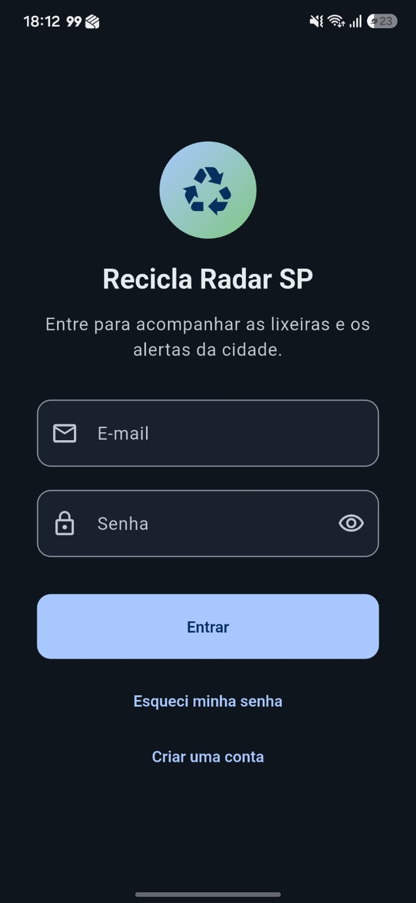
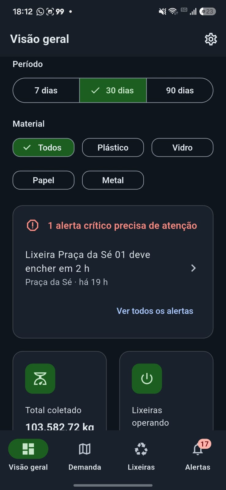
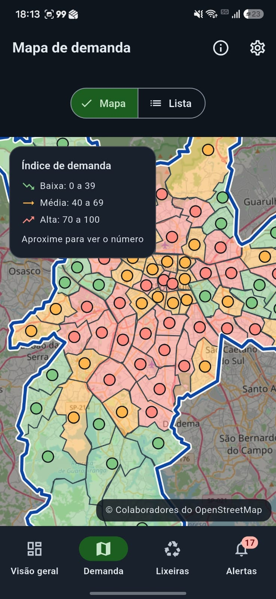
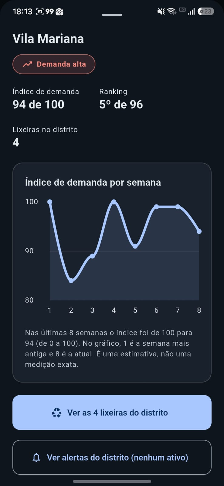
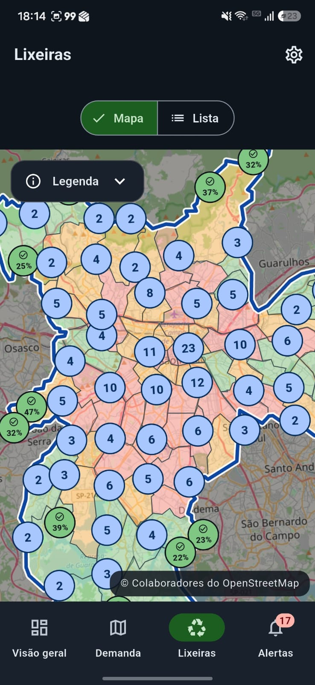
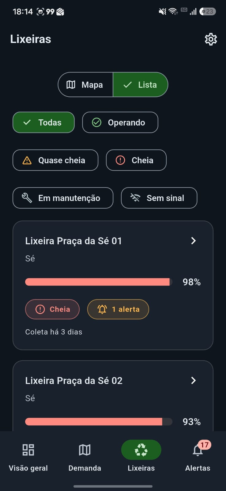
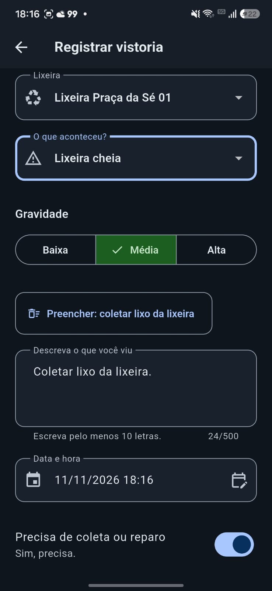
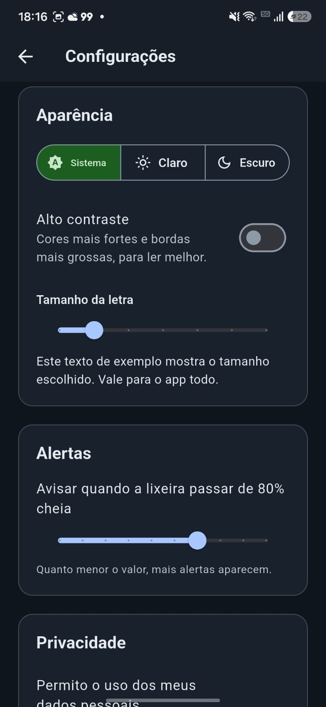

# Recicla Radar SP

Painel de inteligência territorial que mostra a fiscais e gestores da limpeza urbana de São Paulo onde há mais demanda de descarte, quais lixeiras de reciclagem estão enchendo ou sem sinal e quais alertas pedem atenção.

> **O app sugere, a pessoa decide.** Nenhum alerta toma ação sozinho: cada um traz evidência, confiança e limitações, e a decisão final é sempre humana.

Global Solution 2026.2 · FIAP · Cross-Platform Application Development · Desafio *Territory Predictive Insights*.

---

## Ideia inicial

**Problema.** Em São Paulo, as lixeiras de reciclagem ficam mal distribuídas em relação a onde mais se descarta, e quem fiscaliza só descobre que uma lixeira encheu, quebrou ou parou de enviar dados quando o problema já aconteceu.

**Público.** Fiscais e gestores da limpeza urbana.

**Solução.** Um app Flutter que reúne num só lugar os indicadores da cidade, a localização das lixeiras e alertas preditivos, e deixa o fiscal registrar vistorias em campo.

**Impacto esperado.** Mais material reciclável desviado do aterro (indicador de benefício social exibido no app) e manutenção mais rápida.

### Como o projeto evoluiu

1. **Base:** tema claro e escuro, modelos, rotas e as telas principais com dados fixos.
2. **Mapas e dados:** pontos de descarte e lixeiras distribuídos pelos 96 distritos, com o contorno dos distritos vindo do OpenStreetMap.
3. **Alertas de verdade:** os alertas passaram a ser calculados a partir das leituras das lixeiras, e a decisão sobre cada um fica salva no aparelho.
4. **Uso em campo:** vistorias salvas no aparelho, telas ligadas entre si, layout responsivo, alto contraste, cache do mapa para uso sem internet e animações curtas.

## Integrantes

| Nome completo | RM |
| --- | --- |
| Carolina Monteiro Bernardo | 564651 |
| Isabelle Dias Belini | 566464 |
| Júlia Souza Marques | 565010 |

## Demonstração visual

| Login | Criar conta | Visão geral e impacto | Mapa de demanda por distrito |
| :---: | :---: | :---: | :---: |
|  |  |  |  |

| Painel do distrito | Mapa de lixeiras | Lista de lixeiras | Detalhe da lixeira |
| :---: | :---: | :---: | :---: |
|  |  |  |  |

| Lista de alertas | Detalhe do alerta | Registrar vistoria | Configurações |
| :---: | :---: | :---: | :---: |
|  |  |  |  |

## Como o app funciona

O fiscal entra com a conta de demonstração e vê quatro abas:

- **Visão geral:** quilos coletados, lixeiras operando, alertas ativos e material desviado do aterro, com filtros de período (7, 30 e 90 dias) e de material, e gráficos de evolução e de participação de cada material.
- **Demanda:** mapa de São Paulo com os 96 distritos coloridos pelo índice de demanda (0 a 100). Tocar num distrito abre o painel com o histórico semanal do índice e atalhos para as lixeiras e os alertas dele. Há também uma lista como alternativa ao mapa.
- **Lixeiras:** mapa e lista, com filtros por situação. O detalhe mostra o enchimento, a última coleta, os alertas e, em blocos recolhidos, o material coletado, o enchimento dos últimos 7 dias e as vistorias.
- **Alertas:** lista do mais grave ao menos grave (e, em igual gravidade, do mais antigo ao mais novo). Cada alerta mostra os dados que o justificam, como foi calculado, a confiança e suas limitações, e permite marcar como *Em análise*, *Resolvido* ou *Descartado*. Alertas resolvidos ou descartados saem da lista e ficam numa seção que se abre e se fecha.

Alerta, lixeira e distrito se levam uns aos outros (por exemplo, do alerta para a lixeira, para o mapa e para o distrito). O selo da aba Alertas conta só os alertas ativos ainda não lidos; cada alerta pode ser marcado como lido ou não lido, ou todos de uma vez.

**Vistoria:** formulário com lixeira, tipo de ocorrência, gravidade, descrição, data e hora e se precisa de coleta ou reparo, com validação e um atalho que preenche "Coletar lixo da lixeira". Vistorias graves geram alerta.

**Configurações:** tema (sistema, claro ou escuro), alto contraste, tamanho da letra, limiar de enchimento dos alertas e consentimento de uso dos dados pessoais.

## Funcionalidades

- [x] 11 rotas nomeadas com passagem de parâmetros (`/lixeiras/:id`, `/alertas/:id`, `/vistoria?binId=`...)
- [x] 3 dashboards: visão geral, demanda por distrito e lixeiras, com gráficos, cards e histórico
- [x] Alertas calculados a partir dos dados, com evidência, confiança e limitações
- [x] Aviso visível de que os alertas apoiam, mas não substituem, a decisão humana
- [x] Estado global compartilhado entre telas, com carregando, erro e lista vazia
- [x] Dados de serviço externo (OpenStreetMap) e dados simulados por repositórios
- [x] Persistência local: status e leitura dos alertas, vistorias, configurações e contorno do mapa
- [x] App útil sem conexão (dados e cache no aparelho)
- [x] Formulários com validação (login, cadastro, recuperar senha e vistoria)
- [x] Tema claro, escuro e de alto contraste; layout responsivo
- [x] Acessibilidade, consentimento e indicador de benefício social
- [x] Mapa com os indicadores por distrito
- [x] Animações curtas e testes automatizados (mais de 200)

## Dados e alertas

**Fonte dos dados.** Os pontos de descarte, as lixeiras e as leituras são **sintéticos**, criados para o projeto a partir da lista real de distritos (`tool/gerar_distritos.py` consulta o OpenStreetMap uma vez para sortear pontos dentro de cada distrito). O contorno de São Paulo e dos 96 distritos vem do **OpenStreetMap** (serviço Nominatim) e fica guardado no aparelho depois da primeira busca.

**Como os alertas são gerados** (`lib/domain/alert_engine.dart`). Cada regra lê as leituras das lixeiras e devolve alertas com id estável, para a decisão da pessoa não se perder quando os dados são recalculados.

| Alerta | Dispara quando | Gravidade |
| --- | --- | --- |
| Previsão de enchimento | Enchimento acima do limiar das Configurações (padrão 80%) ou lotação prevista em até 24 h | Crítica até 4 h, alta até 12 h, média até 24 h |
| Sem sinal | Nenhuma leitura há mais de 12 h | Alta; crítica acima de 48 h |
| Leitura fora do padrão | Um material passa de 2 vezes a média de 30 dias, por 2 dias seguidos ou mais | Média; alta a partir de 3 vezes |
| Coleta abaixo do esperado | Volume do distrito em 7 dias cai mais de 15% contra a média das 4 semanas anteriores | Média; alta acima de 30% |
| Demanda alta com pouca cobertura | Índice 85 ou mais e no máximo 2 lixeiras funcionando | Média; alta sem nenhuma |
| Vistoria de campo | Vistoria dos últimos 7 dias grave, ou que aponta lixeira danificada ou vandalizada | Crítica, alta ou média |

**Métricas.** Ritmo de enchimento (% por hora, desde a última coleta), média de 30 dias por material, variação semanal de volume por distrito e índice de demanda (posição do distrito em relação aos demais). A **confiança** (alta, média ou baixa) vem da quantidade de leituras, da regularidade do ritmo, dos dias seguidos e de quantas lixeiras do distrito foram afetadas, e o motivo aparece escrito no alerta.

**Limitações e vieses.**
- Os dados são simulados: os números mostram o funcionamento, não a realidade de São Paulo.
- O percentual de material reaproveitado (75%) é uma suposição do projeto, não uma medição oficial.
- O índice de demanda é relativo (compara distritos entre si) e pode esconder distritos pequenos ou com poucos pontos de descarte.
- A previsão supõe ritmo de enchimento constante; descartes em eventos ou feriados a tornam menos precisa.

**Quando a previsão não é confiável.** Com menos de 4 leituras desde a última coleta o app **não prevê** o tempo de enchimento e avisa que não há dados suficientes. Lixeira sem sinal, em manutenção ou recém-coletada também tem previsão fraca, e a confiança cai.

## Privacidade e inclusão

- **Consentimento:** o cadastro pede o aceite, e as Configurações permitem mudar a escolha. Com o consentimento ligado, a vistoria leva o nome de quem registrou; desligado, é registrada de forma **anônima**. O formulário avisa qual dos dois vale.
- **Dados pessoais mínimos:** só o nome, e só com consentimento. Tudo fica no aparelho (`shared_preferences`); não há servidor.
- **Contas no aparelho:** o cadastro cria a conta no próprio aparelho, e ela continua existindo depois de fechar o app. A senha não é guardada em texto, só um resumo (SHA-256 com sal). Como não há servidor, o login serve para demonstrar o fluxo e não oferece segurança real.
- **Acessibilidade:** contraste WCAG AA nos temas claro e escuro e AAA (7:1) no de alto contraste, verificados por teste; tamanho de letra ajustável e respeito à fonte do sistema; alvos de toque de pelo menos 48 dp; gravidade e status sempre com ícone e texto, nunca só cor; descrições para leitores de tela em botões, gráficos e marcadores; animações desligadas quando o aparelho pede menos movimento.

## Tecnologias e decisões técnicas

| Escolha | Por quê |
| --- | --- |
| Flutter (Material 3) | Um código só, com componentes prontos e temas claro e escuro |
| `go_router` | Rotas nomeadas, parâmetros e abas que mantêm o estado |
| `provider` | Estado global simples (`ChangeNotifier`), com carregando, erro e vazio em um só lugar |
| `flutter_map` + OpenStreetMap | Mapas sem chave de API e com cache dos tiles |
| `fl_chart` | Gráficos de linha, barras e pizza |
| `shared_preferences` | Preferências, status e leitura dos alertas e vistorias no aparelho |
| `path_provider` | Pasta onde fica o cache do contorno dos distritos |
| `http` | Consulta ao Nominatim |
| `intl` | Datas e números em português, com duas casas decimais |

**Arquitetura.** Camadas separadas, para trocar a fonte dos dados sem mexer nas telas (basta passar outras implementações em `lib/app.dart`):

```
lib/
  core/       tema, rotas, mapa, layout responsivo e componentes reutilizáveis
  data/       modelos, repositórios (interfaces e implementações), dados simulados, OpenStreetMap e armazenamento local
  domain/     regras e motor de alertas
  state/      providers
  features/   telas: auth, overview, demand_map, bins_map, alerts, inspection, settings
test/         testes de regras, validadores, contraste, navegação, persistência e layout
tool/         script que gera os pontos de descarte
```

## Como executar

Requisitos: [Flutter](https://docs.flutter.dev/get-started/install) 3.x e um emulador ou celular Android (a plataforma testada). Não há variáveis de ambiente nem chaves de API.

```bash
git clone https://github.com/jumarques03/recicla-radar-sp.git
cd recicla-radar-sp
flutter pub get
flutter devices            # lista os dispositivos
flutter run -d <id>        # roda no dispositivo escolhido
```

Conta de demonstração: e-mail `fiscal@reciclaradar.sp` e senha `senha123`.

Outros comandos:

```bash
flutter analyze            # análise estática
flutter test               # testes automatizados
flutter build apk          # gera o APK de release
```

O contorno dos distritos é buscado na internet na primeira vez que o app abre; depois fica guardado e o app funciona sem conexão.

## Vídeo

Demonstração de até 3 minutos: _adicionar link do vídeo_

## Licença

Projeto acadêmico da FIAP, Global Solution 2026.2. Os dados do mapa são © colaboradores do OpenStreetMap, sob a licença ODbL.
